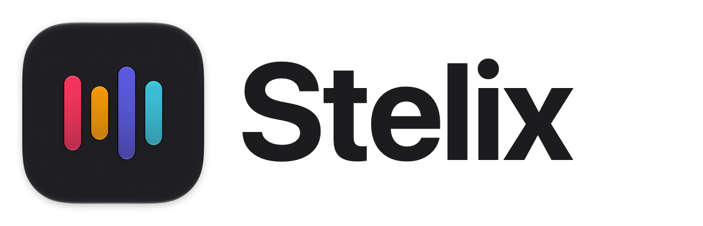
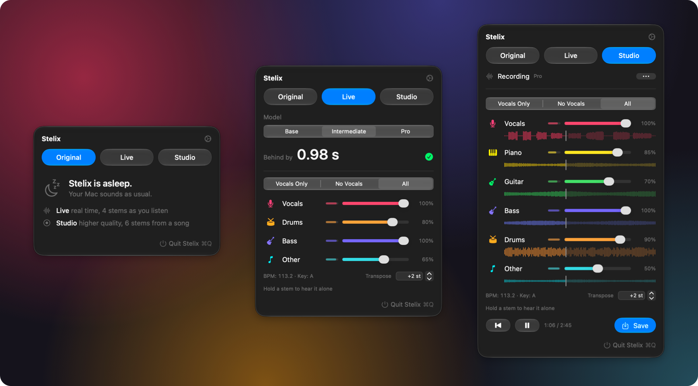

<p align="center">
  <picture>
    <source media="(prefers-color-scheme: dark)" srcset="assets/logo-on-dark.png">
    
  </picture>
</p>

<h3 align="center">Live stem separation for your Mac</h3>

<p align="center">
  
  
  
  
</p>

<p align="center">
  <a href="https://github.com/stelix-app/stelix/releases/latest"><b>⬇️ Download the latest version</b></a> · <a href="https://getstelix.com">🌐 getstelix.com</a>
</p>

<p align="center">
  
</p>

Stelix is an **always-ready** menu bar app for Apple silicon Mac computers that splits the audio of your Mac into stems: vocals, drums, bass and the rest. It does it **live**, while the music plays, or from a recording or a file, with higher quality and six stems.

## ✨ What it does

- 🎚️ **Live.** Whatever your Mac plays, split into 4 stems (vocals, drums, bass, other), about one second behind on a fast Mac. Turn each stem up or down, hold one to hear it alone, or pick a preset such as "Vocals Only". Works with any app, with no audio driver to install.
- 🎛️ **Studio.** Record what your Mac plays, or drop an audio file, and get 6 stems (vocals, drums, bass, guitar, piano, other). Play them in the built-in player and save them as WAV files in `~/Music/Stelix`.
- 🎼 **Transpose.** Move Live and Studio up or down by up to 12 semitones, while the drums stay as they are. In Live it adds about 0.1 seconds to the delay. In Studio, the "Save" button writes the transposed stems to a separate folder.
- 🥁 **BPM and key.** On macOS 27 and later, Live and Studio show the tempo and the key under the stems, and both follow the song when they change. The key follows the transpose too. They come from Apple's on-device Music Understanding framework, so earlier versions of macOS don't show them.
- 🌙 **Original.** The app sleeps and your Mac sounds as usual: no background process, 0% CPU, about 20 MB of memory (about 40 MB after an hour of Live). The separation engine runs only while you are in Live or Studio.
- 🔒 **On your Mac.** Everything runs on your Mac. Audio never leaves it.

<details>
<summary><b>Why Studio sounds better than Live</b></summary>

Live has to keep up with the music: it runs the htdemucs model on 7.8-second windows and reads each result near its edge, so you hear it about one second later. Studio works on the whole recording, with no deadline and larger models (htdemucs_6s at Base, BS-Roformer at Intermediate and Pro). Use Live to play along, Studio to keep the stems.

</details>

<details>
<summary><b>What the audio goes through</b></summary>

In Original the app is not in the audio path at all: no background process, no audio tap, no virtual device, so sample rate, bit depth and lossless playback are exactly what macOS gives you. Live is not bit-perfect: the audio is mixed to stereo, converted to the model's sample rate, separated and mixed again.

</details>

## 💻 Requirements

- A Mac with Apple silicon.
- macOS 15 or later. Before macOS 26 the app has the look that came before Liquid Glass.
- About 2.3 GB of free space for all the models.

How fast it runs depends on your Mac: see [Performance](#-performance).

## 📥 Install

> [!NOTE]
> Stelix is not notarized by Apple, so the first time macOS asks you to confirm. It takes a minute, once.

1. **Copy it.** Download the DMG from [Releases](https://github.com/stelix-app/stelix/releases), open it and **drag the Stelix icon onto the Applications folder**: that is the whole installation. Then eject the DMG (⏏ next to "Stelix" in the Finder sidebar) and open Stelix from Applications or Spotlight. Opened from the DMG window it runs from a temporary copy, which stops working when the DMG is ejected.
2. **Open it once.** macOS says "Stelix.app" Not Opened, because Apple could not verify it is free of malware. Click **Done**, not Move to Trash.
3. **Allow it.** In System Settings → Privacy & Security, scroll down to Security and click **Open Anyway** under the message about Stelix. The button appears only after step 2.
4. **Confirm.** Click **Open Anyway** again and enter your password or use Touch ID. From now on Stelix opens normally.

<details>
<summary>Alternative, from Terminal</summary>

Only for a DMG downloaded from this repository's Releases page, after checking its SHA-256 against the one in the release notes. It removes the quarantine from the app and from every file inside it:

```
xattr -dr com.apple.quarantine /Applications/Stelix.app
```

</details>

### 🔄 Updating

- Once a day Stelix checks this repository's latest release. When there is a newer version, a window opens with what's new, in the app's language. "Check Now" in the settings checks at once.
- **Download** saves the DMG in your Downloads folder. First Stelix checks that the app inside is the announced version, signed with the same certificate as yours; if not, it deletes the file. **Later** asks again in two days, **Skip This Version** waits for the next one; the settings show the new version anyway.
- Quit Stelix, open the DMG and drag the new Stelix to Applications, choosing Replace. Your models, settings and audio permission stay.

You can also download the DMG from [Releases](https://github.com/stelix-app/stelix/releases) yourself, as for the first install.

### 🎙️ Audio permission

The first time you choose Live, or record in Studio, macOS asks for permission to record the system audio: without it there is nothing to separate. You can change it in System Settings → Privacy & Security → Screen & System Audio Recording. If you allow it there later, macOS offers to quit and reopen Stelix; if it does not come back by itself, open it from Applications.

## ⚡ Performance

Measured on a MacBook Pro M3 Max (30 GPU cores, 36 GB of memory) on macOS 27:

| | Base | Intermediate | Pro |
|---|---|---|---|
| **Live**, one pass of the model | 0.19 s | 0.19 s | 0.8 s |
| **Studio**, a four-minute song | 11 s | 26 s | 77 s |
| **Studio** memory, a four-minute song | about 3 GB | 8 to 9 GB | 8 to 9 GB |
| **Studio** memory, the longest file (20 minutes) | 7 GB | 16 to 18 GB | 16 to 18 GB |

- **Live needs a fast GPU.** The model runs every 0.3 to 1 second and has to finish in time. When it starts, Live measures your Mac: if a level does not fit, it waits longer instead of falling behind, and "Behind by" grows, up to 5 seconds. It does the same if your Mac slows down later. A level that would need more does not start, and the app tells you to pick a lower one.
- **MacBook Air M2** (16 GB of memory, macOS 27): everything works as on the M3 Max except Live at Pro, which does not start because the Mac is too slow for it. Live at Intermediate is 1.7 seconds behind (1.0 on the M3 Max).
- **Other Macs**, an estimate from those two: an M-series Pro chip should run every level, Pro with 4 to 5 seconds of delay. The chips with 8 to 10 GPU cores (no Pro or Max in the name) run Base and Intermediate, with more delay, and are too slow for Pro.
- **Studio has no deadline**, so it should work on any Apple silicon Mac, only slower. With 8 GB of memory, use Base.

## ⚠️ Known issues

- So far tested only on macOS 27: macOS 15 and 26 are supported, but untested.
- On the Macs not tried yet, Live may have more delay than on the M3 Max, and Pro may not start (see [Performance](#-performance)).
- The BPM can be half, double or one and a half times the tempo you would tap, as with any tempo detector, and on speech or noise it may show a number anyway. In Live it is the tempo around what you are hearing, updated every 4 seconds, only while the panel is open.
- The key is right on most songs. On very complex music, such as songs that move between keys or use unusual harmony, it can be wrong: for example it may show the relative minor (Cm) instead of the major key (E♭). When Stelix is not sure, it shows "—".
- Some apps write WAV files whose length field is left empty while recording: those cannot be opened. Save them again with any audio editor.

## 🧠 Models

The separation is done by neural network models. **Model weights are not included in or hosted by this project. Stelix downloads them on request from their original sources and verifies their SHA-256.** Before each download the app shows where the file comes from, who made it and what is known about its license, and you decide.

| Model | Used by | Size | Source | Author | License of the weights |
|---|---|---|---|---|---|
| htdemucs | Live, Base and Intermediate | 168 MB | [ssmall256/demucs-mlx](https://huggingface.co/ssmall256/demucs-mlx) on Hugging Face | Alexandre Défossez (Meta); MLX conversion by ssmall256 | Not clear, according to the author. The conversion's repository labels them MIT. |
| htdemucs_ft | Live, Pro | 672 MB | same | same | same |
| htdemucs_6s | Studio, Base | 110 MB | same | same | Not clear; the author says a non-commercial license (CC BY-NC) likely applies. The conversion's repository labels them MIT. |
| BS-Roformer SW | Studio, Intermediate and Pro | 699 MB | [python-audio-separator](https://github.com/nomadkaraoke/python-audio-separator) releases | Not stated | None declared. Its origin is not verified. |
| BS-Roformer ep_317 | Studio, Pro (vocals) | 639 MB | [TRvlvr/model_repo](https://github.com/TRvlvr/model_repo) releases | viperx | None declared. |

On the Demucs weights, the [Demucs README](https://github.com/adefossez/demucs#license) says: "The license of the weights is not clear". Treat every model as for personal use.

If a source disappears, the app says so and offers **Add Model…**, which accepts a file you already have and checks it against the same SHA-256.

## 🔐 Privacy

- **Nothing collected.** No account, no analytics, no telemetry.
- **Audio stays on your Mac.** It is captured, separated and saved there only.
- **Network.** The only connections are the model downloads you start, from GitHub, Hugging Face and their download servers, and the update check: once a day the app asks GitHub for this repository's latest release, and downloads the DMG only when you click Download. All go over HTTPS. Like any request, they show your IP address to those services; the update check sends nothing else, no identifier and no usage data. You can turn it off in the settings, "Check for updates automatically". The separation engine never connects to the network.
- **Logs.** What the app writes in the macOS system log does not include the names of your files or of your audio devices.
- **Website.** How the website [getstelix.com](https://getstelix.com) and the app handle personal data is in the [privacy policy](https://getstelix.com/privacy/), also linked from About.

## 🤖 About the AI in this app

The stems are computed by machine learning models. They are an estimate, not the original multitrack: expect artifacts and some bleed between stems. Files saved by Studio are AI-processed versions of the audio you gave it, and each of them says so in its own metadata: the WAV's software and comment fields name the app and the model that separated it, for example "Stem separated by an AI model (htdemucs_6s)".

## 🎵 Music and copyright

The app separates whatever your Mac plays and whatever file you give it. Having the right to do that is your responsibility.

- Recording or separating music from a streaming service may be against that service's terms, and in some countries against the law.
- The stems of a copyrighted recording are still covered by that copyright. Keep them for your own practice and study unless the rights holders allow more.

## 🗑️ Uninstall

1. In the app's settings turn off "Open Stelix at login", then quit the app.
2. Delete `/Applications/Stelix.app`.
3. Delete the models: `~/Library/Application Support/Stelix`.
4. Delete the preferences: `defaults delete io.github.stelix-app.stelix`.
5. Optionally reset the audio permission: `tccutil reset AudioCapture io.github.stelix-app.stelix`.

Your saved stems are in `~/Music/Stelix`: keep them or delete them.

<details>
<summary>A few small files are left outside those folders</summary>

They hold no audio and nothing about you, and you can delete them too:

- `~/Library/Caches/mlx-spectro` and `~/.cache/mlx-audio-separator`: written by the separation libraries the first time you used Studio at Intermediate or Pro.
- The compiled GPU programs that macOS keeps for the app, about 70 MB: the folders `io.github.stelix-app.stelix` and `org.python.python` inside the folder that `getconf DARWIN_USER_CACHE_DIR` prints.

While it runs, the app keeps recordings and stems you have not saved in the system's temporary folder, and removes them when it quits.

</details>

## 🛠️ Build from source

You need Xcode 27 or later, [XcodeGen](https://github.com/yonaskolb/XcodeGen) and [uv](https://docs.astral.sh/uv/).

```
scripts/make-signing-identity.sh   # once: creates a local signing certificate in your login keychain
scripts/build.sh                   # builds, signs and installs into /Applications
scripts/test.sh                    # runs the tests
```

- `scripts/build.sh --no-install` stops after the build.
- To sign with your own certificate, set `STELIX_SIGN_IDENTITY` to its name. It must be a real certificate, not an ad-hoc signature: macOS ties the audio permission to the certificate, and with an ad-hoc signature it would ask again after every build. The build exits with code 77 if the signature does not pin a certificate.
- Dependencies are pinned in `Package.resolved` and `sidecar/uv.lock`.

## 🤝 Contributing

See [CONTRIBUTING.md](CONTRIBUTING.md). It also explains the license terms for contributions.

## 📄 License

Copyright (C) 2026 Gabriele Carsana.

Stelix is free software under the [GNU General Public License, version 3](LICENSE) (`GPL-3.0-only`), with the additional terms in [NOTICE](NOTICE): modified versions must keep the author attribution, say that they are modified, and not use the name and icon as their own. It comes without any warranty.

The app includes software by other people. [THIRD_PARTY_NOTICES.md](THIRD_PARTY_NOTICES.md) lists every component with its license; the same file is inside the app and opens from its About window. Two of those components, LAME and the SoX Resampler library, are under the GNU LGPL: their source code is published with every release, in the archive of LGPL sources next to the DMG.

The source code of each release is the tag of that release in this repository, with the dependencies at the versions pinned in it.

Mac and macOS are trademarks of Apple Inc., registered in the U.S. and other countries and regions. This project is not affiliated with or endorsed by Apple, Meta, Hugging Face, GitHub or the authors of the models.
